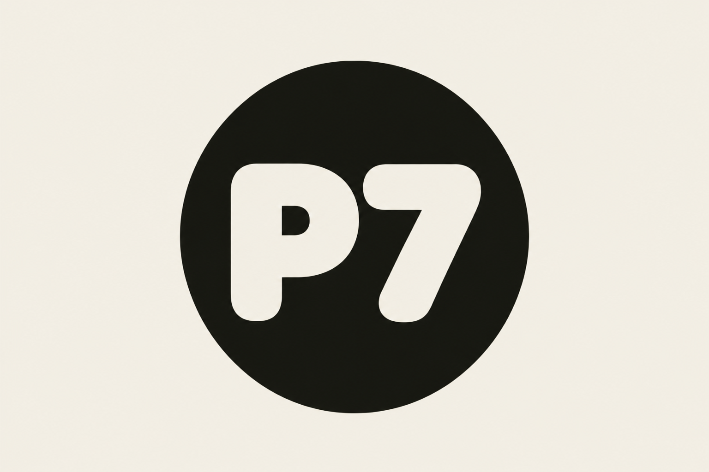

# p7 · Privacidad, descifrada.

<p align="center">
  
</p>

<p align="center"><strong>Lee lo que aceptas. Sigue el rastro de tus datos.</strong></p>
<p align="center">Un lector de políticas de privacidad en español e inglés impulsado por un modelo de lenguaje local.</p>

<p align="center">
  <a href="README.md">English</a> ·
  <a href="https://youtu.be/xO7PG6xwfb8">Ver video</a> ·
  <a href="#prueba-p7">Prueba p7</a> ·
  <a href="#qué-hace-p7">Funciones</a> ·
  <a href="#evaluación-y-límites-reales">Evaluación</a> ·
  <a href="docs/README.es.md">Documentación</a>
</p>

---

## El problema

Las personas aceptan políticas de privacidad sin saber qué prácticas les afectan, qué deja sin aclarar el documento o qué pueden hacer después. Un resumen genérico no responde esas preguntas personales.

**p7 convierte una política pegada en una lectura personalizada y vinculada con evidencia.** Identifica prácticas declaradas, representa el recorrido descrito de los datos, señala vacíos de información, explica posibles impactos y sugiere acciones. Es una aplicación local funcional creada para el [hackathon de IA STEM2Connect](https://stem2connect-online-hackathon.devpost.com/) en la categoría **Community Impact**.

**[Mira la demostración de 3:49 en YouTube](https://youtu.be/xO7PG6xwfb8).** Muestra la aplicación funcionando con un ejemplo ficticio y compara dos perfiles de privacidad.

> **Alcance:** p7 lee lo que dice un documento. No observa flujos reales de datos, no decide si un servicio cumple la ley y no sustituye una revisión humana o jurídica.

## Prueba p7

**Requisitos:** Docker Desktop y acceso a internet para descargar contenedores y modelo la primera vez. Después, el modelo se ejecuta localmente; no se necesita una clave API de pago.

```powershell
docker compose up --build --wait
```

Abre **http://localhost:3000** → elige **Español** o **English** → pulsa **Cargar ejemplo** → selecciona un perfil → **Analizar política**. La política incluida es ficticia; también puedes pegar tu texto. Para comparar perfiles, selecciona otro y **vuelve a analizar**. La aplicación no descarga políticas desde URL.

En Windows, `iniciar.cmd` inicia el mismo conjunto y abre el navegador. Detén los servicios con `docker compose down`. Si Docker Hub no responde, sigue [Ejecutar sin Docker](#ejecutar-sin-docker).

## Qué hace p7

| Capacidad | Qué ve la persona |
| --- | --- |
| **1 · Mapa de datos** | Un diagrama del recorrido descrito en la política, no del tráfico real de red. |
| **2 · Riesgo personal** | Un índice reproducible ponderado para Uso general, Estudiante, Periodista, Padre/Madre o Activista. |
| **3 · Detección de vacíos** | Información clasificada como especificada, ambigua o ausente. |
| **4 · Evidencia verificable** | Hallazgos vinculados a cláusulas e identidad SHA-256 del documento analizado. |
| **5 · Simulación de impacto** | Consecuencias posibles etiquetadas claramente como escenarios. |
| **6 · Consentimiento inteligente** | Pasos priorizados que la persona puede revisar o tomar. |
| **7 · Privacidad para todos** | Interfaz, políticas de ejemplo e informes completos en español e inglés. |

La API Go divide la política en cláusulas. **Ollama `qwen3:4b-instruct`** realiza siete pasadas enfocadas de clasificación semántica por lote de cláusulas y propone hallazgos estructurados. Go comprueba los nombres de categorías y que cada cita aparezca en la cláusula referida, elimina duplicados y aplica pesos fijos por perfil para calcular el índice. Una coincidencia textual **no** prueba que el modelo interpretó bien la cláusula.

## Evaluación y límites reales

Conservamos prompts, casos etiquetados, enlaces a fuentes oficiales y salidas crudas en el [directorio de evaluación](apps/api/evaluation). El [historial en español](docs/es/EVALUATION.md) y el [historial en inglés](docs/en/EVALUATION.md) explican todas las rondas.

| Evaluación | Precisión | Cobertura | Resultados exactos |
| --- | ---: | ---: | ---: |
| Ronda 9 · 40 fragmentos oficiales seleccionados | 100,0 % | 75,0 % | 30/40 casos |
| Ronda 10 · primeras políticas completas | 54,5 % | 60,0 % | 1/4 páginas |
| **Ronda 18 · última pasada reparada con políticas completas** | **87,5 %** | **70,0 %** | **0/4 páginas** |

La última fila abarca cuatro páginas localizadas de Dropbox y Airbnb: **14 verdaderos positivos, 2 falsos positivos y 6 categorías omitidas** según las etiquetas de esa ronda. Una revisión adicional de una persona consideró pertinentes **13 de 16** citas conservadas. La pasada reparada reutilizó las mismas páginas después de corregir un fallo de citas en PDF; una etiqueta de Dropbox también contradice una ronda anterior. Estas muestras pequeñas, seleccionadas y correlacionadas **no** establecen exactitud general ni fiabilidad del 90 %. Consulta el [estudio de la ronda 18](docs/es/ROUND18_CASE_STUDY.md) y la [salida cruda](apps/api/evaluation/real_policies_round18_result.json).

## Ejecutar sin Docker

Instala [Go](https://go.dev/dl/), [Node.js](https://nodejs.org/) y [Ollama](https://ollama.com/download). Descarga el modelo una vez:

```powershell
ollama pull qwen3:4b-instruct
```

Inicia la API en una terminal PowerShell:

```powershell
cd apps/api
$env:P7_API_PORT = "8080"
$env:P7_OLLAMA_URL = "http://127.0.0.1:11434"
$env:P7_OLLAMA_MODEL = "qwen3:4b-instruct"
go run ./cmd/server
```

Inicia la web en otra terminal:

```powershell
cd apps/web
npm ci
$env:NEXT_PUBLIC_API_URL = "http://localhost:8080"
npm run dev
```

Abre **http://localhost:3000**. Si los puertos están ocupados, usa valores compatibles para `P7_API_PORT`, `P7_ALLOWED_ORIGINS` y `NEXT_PUBLIC_API_URL`, y arranca Next.js con `npm run dev -- -p <puerto-web>`. La prueba local utilizó API `18080` y web `13000`.

## Arquitectura y verificación

| Capa | Implementación |
| --- | --- |
| Web | Next.js 16, React 19, TypeScript |
| API | Biblioteca estándar HTTP de Go |
| IA | Ollama local, `qwen3:4b-instruct`; sin API de pago ni clave de la aplicación |
| Pruebas | Go, Vitest, TypeScript, build de producción, auditoría de dependencias, paridad bilingüe |
| Ejecución | Docker Compose y GitHub Actions |

Ejecuta las verificaciones con `./scripts/test-all.ps1` en PowerShell. GitHub Actions las repite en pushes y solicitudes de cambio.

El endpoint es `POST /api/v1/analyze`. Recibe `title`, `text`, `locale` (`en` o `es`) y `profile` (`general`, `student`, `journalist`, `parent` o `activist`). Consulta la [arquitectura](docs/es/ARCHITECTURE.md) para el flujo de respuesta.

**Límites operativos:** la API limita el tamaño de las peticiones y los documentos. El MVP no tiene cuentas ni almacena intencionalmente las políticas. `P7_ALLOWED_ORIGINS` configura CORS. El texto de la política es entrada no confiable; la inyección de instrucciones sigue siendo un riesgo del modelo. Los resultados son informativos, no asesoramiento jurídico.

## Declaración de IA y materiales

El producto usa el LLM local descrito arriba. ChatGPT y Codex también ayudaron con investigación, alcance, arquitectura, código, diseño, pruebas y documentación. El video usa narración sintetizada localmente mediante Kokoro y se montó con HyperFrames. Revisamos y probamos ese trabajo. Consulta el [índice bilingüe](docs/README.es.md) y el [historial de evaluación](docs/es/EVALUATION.md).

La [galería de presentación](docs/assets/devpost-gallery/ready-1500x1000/) contiene ocho imágenes del producto. [Mira la demostración](https://youtu.be/xO7PG6xwfb8) en YouTube.

## Licencia

[MIT](LICENSE).
