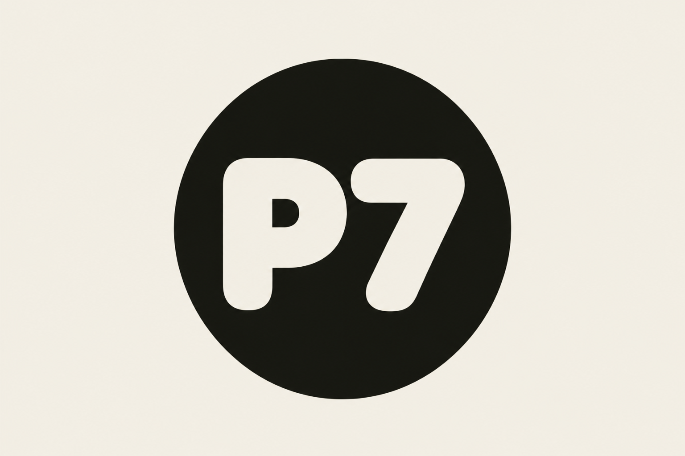

# p7 · Privacy. Decoded.

<p align="center">
  
</p>

<p align="center"><strong>Read what you accept. Follow your data trail.</strong></p>
<p align="center">An English and Spanish privacy-policy reader powered by a local language model.</p>

<p align="center">
  <a href="README.es.md">Español</a> ·
  <a href="#try-p7">Try p7</a> ·
  <a href="#what-p7-does">Features</a> ·
  <a href="#evaluation-and-honest-limits">Evaluation</a> ·
  <a href="docs/README.md">Documentation</a>
</p>

---

## The problem

People routinely accept privacy policies without knowing which practices affect them, what the document leaves unclear, or what they can do next. A generic summary does not answer those personal questions.

**p7 turns a pasted policy into an evidence-linked, personalized reading.** It identifies declared practices, maps the described data path, checks disclosure gaps, explains possible impacts, and suggests actions. It is a working local application built for the [STEM2Connect AI Hackathon](https://stem2connect-online-hackathon.devpost.com/) in the **Community Impact** track.

> **Scope:** p7 reads what a document says. It does not observe real data flows, decide whether a service is lawful, or replace human or legal review.

## Try p7

**Requirements:** Docker Desktop and internet access for the first container and model download. The model runs locally after setup; no paid API key is required.

```powershell
docker compose up --build --wait
```

Open **http://localhost:3000** → choose **English** or **Español** → **Load example** → choose a profile → **Analyze policy**. The bundled policy is fictional; you can paste your own text. To compare profiles, select another one and **analyze again**. The app does not fetch policy URLs.

On Windows, `iniciar.cmd` starts the same stack and opens the browser. Stop with `docker compose down`. If Docker Hub is unavailable, follow [Run without Docker](#run-without-docker).

## What p7 does

| Capability | What the user sees |
| --- | --- |
| **1 · Data mapping** | A diagram of the path described in the policy, not observed network traffic. |
| **2 · Personal risk** | A reproducible index weighted for General, Student, Journalist, Parent, or Activist. |
| **3 · Gap detection** | Disclosures marked specified, ambiguous, or missing. |
| **4 · Verifiable evidence** | Findings linked to policy clauses and a SHA-256 identity for the analyzed document. |
| **5 · Impact simulation** | Possible consequences clearly labeled as scenarios. |
| **6 · Smart consent** | Prioritized steps the person can review or take. |
| **7 · Privacy for everyone** | Complete interface, sample policies, and reports in English and Spanish. |

The Go API divides the policy into clauses. **Ollama `qwen3:4b-instruct`** makes seven focused semantic-classification passes per clause batch and proposes structured findings. Go checks category names and whether each proposed quote occurs in its cited clause, removes duplicates, and applies fixed profile weights to calculate the index. A text match does **not** prove that the model interpreted the clause correctly.

## Evaluation and honest limits

We keep the prompts, labeled cases, official source links, and raw outputs in [the evaluation directory](apps/api/evaluation). The [English evaluation history](docs/en/EVALUATION.md) and [Spanish history](docs/es/EVALUATION.md) explain all rounds.

| Evaluation | Precision | Recall | Exact results |
| --- | ---: | ---: | ---: |
| Round 9 · 40 selected official excerpts | 100.0% | 75.0% | 30/40 cases |
| Round 10 · first complete policies | 54.5% | 60.0% | 1/4 pages |
| **Round 18 · latest repaired complete-policy run** | **87.5%** | **70.0%** | **0/4 pages** |

The latest row covers four localized Dropbox and Airbnb pages: **14 true positives, 2 false positives, and 6 missed categories** under the round's reference labels. A separate one-reviewer audit found **13 of 16** retained citations semantically supportive. The repaired run reused the same pages after a PDF citation fix; a Dropbox label also conflicts with an earlier round. These small, selected, correlated samples do **not** establish general accuracy or 90% reliability. See the [round-18 case study](docs/en/ROUND18_CASE_STUDY.md) and [raw result](apps/api/evaluation/real_policies_round18_result.json).

## Run without Docker

Install [Go](https://go.dev/dl/), [Node.js](https://nodejs.org/), and [Ollama](https://ollama.com/download). Pull the model once:

```powershell
ollama pull qwen3:4b-instruct
```

Start the API in one PowerShell terminal:

```powershell
cd apps/api
$env:P7_API_PORT = "8080"
$env:P7_OLLAMA_URL = "http://127.0.0.1:11434"
$env:P7_OLLAMA_MODEL = "qwen3:4b-instruct"
go run ./cmd/server
```

Start the web app in another terminal:

```powershell
cd apps/web
npm ci
$env:NEXT_PUBLIC_API_URL = "http://localhost:8080"
npm run dev
```

Open **http://localhost:3000**. If those ports are busy, set `P7_API_PORT`, `P7_ALLOWED_ORIGINS`, and `NEXT_PUBLIC_API_URL` to matching values and run Next.js with `npm run dev -- -p <web-port>`. The local verification used API port `18080` and web port `13000`.

## Architecture and verification

| Layer | Implementation |
| --- | --- |
| Web | Next.js 16, React 19, TypeScript |
| API | Go standard HTTP library |
| AI | Local Ollama, `qwen3:4b-instruct`; no paid API or application API key |
| Checks | Go tests, Vitest, TypeScript, production build, dependency audit, bilingual documentation parity |
| Delivery | Docker Compose and GitHub Actions |

Run the project checks with `./scripts/test-all.ps1` in PowerShell. GitHub Actions runs the checks on pushes and pull requests.

The API endpoint is `POST /api/v1/analyze`. It accepts `title`, `text`, `locale` (`en` or `es`), and `profile` (`general`, `student`, `journalist`, `parent`, or `activist`). See the [architecture](docs/en/ARCHITECTURE.md) for the response flow.

**Operational boundaries:** the API limits request and document sizes. The MVP has no accounts and intentionally stores no policy text. `P7_ALLOWED_ORIGINS` configures CORS. Policy text is untrusted input; prompt injection remains a model risk. Results are informational, not legal advice.

## AI disclosure and project materials

The product uses the local LLM described above. ChatGPT and Codex also assisted with research, scope, architecture, coding, design, tests, and documentation. The demo video uses locally synthesized narration via Kokoro and was assembled with HyperFrames. We reviewed and tested that work. See the [submission draft](docs/en/DEVPOST.md), [Spanish submission draft](docs/es/DEVPOST.md), [bilingual documentation index](docs/README.md), and [submission audit](docs/en/SUBMISSION_AUDIT.md).

The [presentation gallery](docs/assets/devpost-gallery/ready-1500x1000/) contains eight product images. The demo video is managed separately from the source repository.

## License

[MIT](LICENSE).
